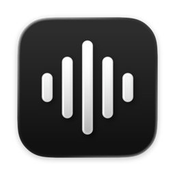
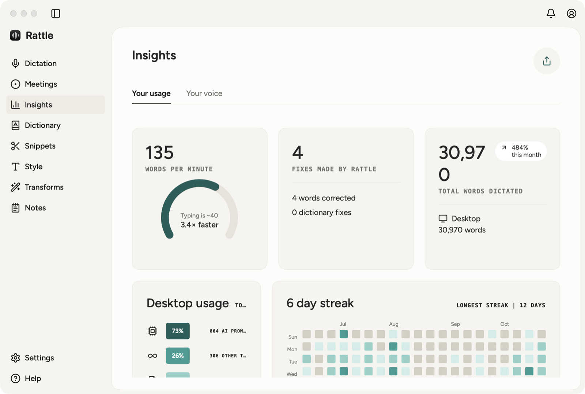
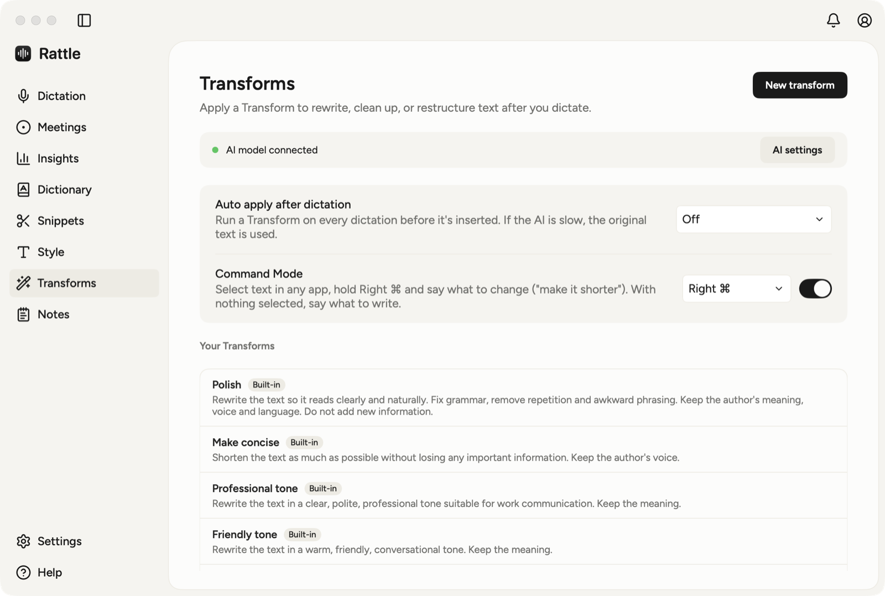
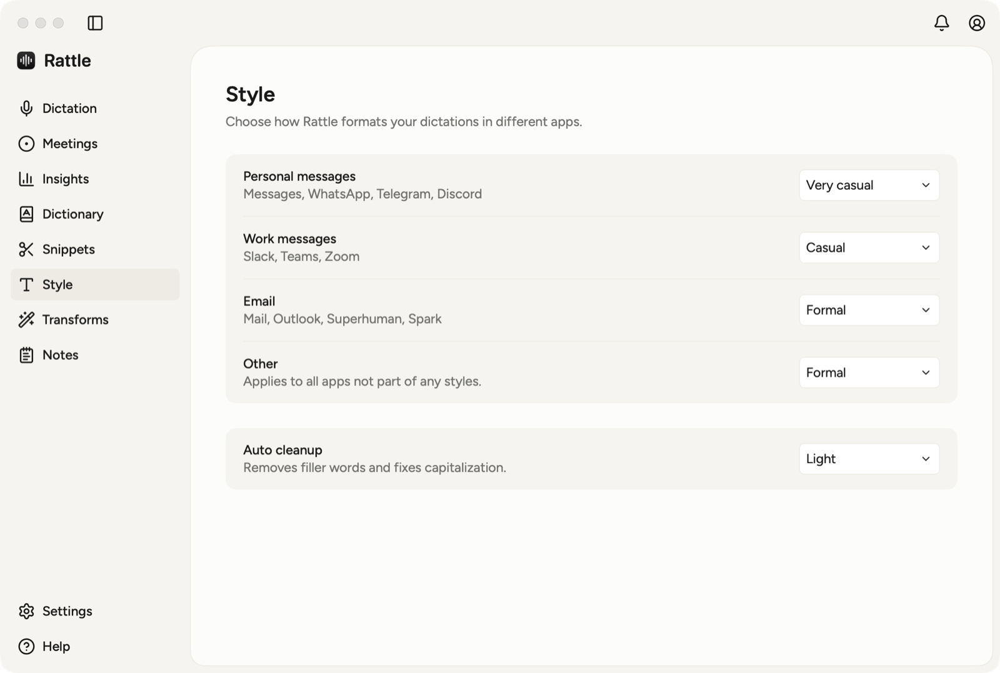

<p align="center">
  
</p>

<h1 align="center">Rattle</h1>

<p align="center">
  <b>Talk instead of typing, anywhere on your Mac.</b><br>
  Native dictation and meeting notes: hold a key, speak, and the text lands wherever your cursor is.
</p>

<p align="center">
  
  
  
  
</p>

<p align="center">
  
</p>

---

## Why Rattle

- **Dictation that works in every app.** Hold `fn`, speak, let go. Rattle cleans the text up and types it into whatever field has focus. No app-specific plugins.
- **Private by default.** Speech is transcribed on your Mac with [whisper.cpp](https://github.com/ggml-org/whisper.cpp). Audio only leaves your Mac if you pick Groq for transcription or a hosted AI server for notes.
- **Meetings without a bot.** Rattle records your mic and the call audio on your Mac, transcribes both sides and writes the notes. Nobody joins your call.
- **Your data is yours to use.** A built-in MCP server lets Claude Desktop, Cursor, Claude Code and other clients search your notes, meetings and dictations.
- **Native.** SwiftUI and AppKit, no Electron, no Xcode project to maintain. One script builds the app.

## Everything it can do

| Area | What you get |
|---|---|
| **Dictation** | Push to talk (`fn`, Right ⌥, Right ⌘ or Right ⌃, or your own shortcut), hands-free mode, Esc to cancel, filler-word cleanup, text typed into the focused app |
| **Meetings** | Records mic and call audio, transcribes both sides, writes notes with your AI model (with Gemini, notes come from the recording itself), and answers questions about your meetings |
| **Notes** | Quick Markdown notes with folders, in a grid or a small floating window |
| **Dictionary** | Names, jargon and spellings Rattle should get right, with optional replacements |
| **Snippets** | Short spoken triggers that expand into text you would otherwise retype |
| **Style** | Tone per kind of app: personal messages, work messages, email and everything else, plus an auto-cleanup level |
| **Transforms** | AI rewrites such as Polish, Make concise, Professional tone and Friendly tone, optionally applied after every dictation, plus your own |
| **Command Mode** | Select text, hold the Command Mode key and say what to change ("make it shorter"). With nothing selected, say what to write |
| **Shortcuts** | Rebind every action, with several chords per action and conflict detection |
| **Insights** | Words per minute, words dictated, corrections made, and a streak calendar |
| **MCP server** | Read access to notes, meetings, dictations and snippets for MCP clients. Editing is off until you allow it |
| **Migration** | Import from Wispr Flow and Granola, export everything as CSV |

<p align="center">
  
</p>

<p align="center">
  
</p>

## Install

**Easiest: one paste.** In Terminal:

```bash
curl -fsSL https://raw.githubusercontent.com/YashDayani/Rattle/main/install.sh | sh
```

It downloads the latest release with `curl`, checks it against the published SHA-256, puts Rattle in `/Applications` and opens it. Downloads made by `curl` are not flagged as "from the internet", so macOS opens the app right away. Run the same line again any time to update.

**Or by hand:**

1. Download **Rattle.zip** from the [Releases](../../releases) page and unzip it.
2. Drag **Rattle.app** into `/Applications`.
3. Rattle is not notarized by Apple yet, so the first time macOS may refuse to open it. Right-click the app, choose **Open**, then **Open** again. If that option is missing, open **System Settings → Privacy & Security** and click **Open Anyway**.

**Requirements:** macOS 14.4 or later (built and tested on macOS 26).

For on-device transcription, install the whisper.cpp engine once. Rattle downloads the speech model itself.

```bash
brew install whisper-cpp
```

## Using it

On first launch a short setup asks for your name, appearance, permissions, speech engine and hold key.

1. **Allow Microphone and Accessibility.** Microphone is for hearing you. Accessibility is for the global hotkey and for typing into other apps.
2. **Dictate.** Hold `fn` and speak. Press `space` while holding to go hands-free, press again to stop. `Esc` cancels.
3. **Pick a speech engine.** *Settings → Model*: **Local** runs whisper.cpp on your Mac (Base and Small, English-only or multilingual). **Cloud** uses Groq's hosted Whisper, which is faster but sends audio to Groq.
4. **Connect an AI model (optional).** *Settings → AI*: any OpenAI-compatible server works for meeting notes and Transforms: LM Studio, Ollama, OpenAI, Gemini, Groq, Mistral or OpenRouter.
5. **Record a meeting.** Open **Meetings** and press **Start meeting** before the call. Rattle writes the notes when you stop.

Settings has tabs for General, Shortcuts, System, Meetings, AI, MCP, Migration, Model and Data and Privacy.

## Connecting an MCP client

Turn on the server in **Settings → MCP**, then use **Connect** for Claude Desktop or Cursor, or copy the config. For Claude Code:

```bash
claude mcp add rattle -- "/Applications/Rattle.app/Contents/MacOS/Rattle" --mcp
```

The server offers these tools:

| Tool | Does |
|---|---|
| `search_rattle` | Search notes, meetings, dictations and snippets |
| `list_notes`, `get_note` | Browse and read notes |
| `list_meetings`, `get_meeting` | Browse meetings, read the summary and transcript |
| `list_dictations`, `list_snippets` | Recent dictations and your snippets |
| `create_note`, `update_note`, `delete_note` | Edit notes (only with **Allow edits** on) |
| `update_meeting`, `delete_meeting` | Edit meetings (only with **Allow edits** on) |

## Where your data lives

Everything stays on your Mac in `~/Library/Application Support/Rattle`: history, notes, meetings, recordings, dictionary, snippets, settings and downloaded models. Nothing is uploaded unless you choose Groq for transcription or a hosted AI server for notes and Transforms. **Settings → Data and Privacy** shows whether transcription is local, lets you clear dictation history and opens the data folder.

## Build from source

You need Xcode or the Xcode Command Line Tools (Swift 5.9 or later).

```bash
./scripts/build.sh
open build/Rattle.app
```

`build.sh` builds a release binary with SwiftPM, assembles `build/Rattle.app` (icon, fonts, illustrations, Info.plist) and signs it.

macOS ties Microphone and Accessibility permissions to the app's signature. To keep those grants across rebuilds, create a stable local signing identity once:

```bash
./scripts/setup-signing.sh
```

Without it, builds are ad-hoc signed and macOS may ask for permissions again after each rebuild.

Run the tests:

```bash
swift test
```

## Releasing (maintainers)

1. Bump `CFBundleShortVersionString` in `scripts/build.sh` and run `./scripts/build.sh`.
2. Zip the app and write its checksum. The installer expects these exact file names:

   ```bash
   ditto -c -k --keepParent build/Rattle.app Rattle.zip
   shasum -a 256 Rattle.zip | awk '{print $1"  Rattle.zip"}' > SHA256SUMS
   ```

3. Publish a GitHub release with both files attached:

   ```bash
   gh release create v1.0.0 Rattle.zip SHA256SUMS --title "Rattle v1.0.0" --generate-notes
   ```

`install.sh` always installs the latest release, so nothing else needs updating.

## How it works

```
Hotkey (CGEvent tap)  →  Audio capture  →  Transcriber (whisper.cpp or Groq)
                                                   │
                          Dictionary · Snippets · Style · Transforms
                                                   │
                                      Inserter  →  focused app
```

| Path | What's there |
|------|--------------|
| `Sources/Rattle/` | The app (SwiftUI views hosted in AppKit windows) |
| `Tests/RattleTests/` | XCTest suite |
| `Illustrations/` | Recoloured Open Doodles used in onboarding and empty states |
| `Fonts/` | Figtree and EB Garamond |
| `Icon/` | App icon (Icon Composer) |
| `scripts/` | Build, signing, icon and illustration scripts, and a Wispr Flow import tool |
| `docs/` | README assets and design notes |

## Known limits

- The app is signed with a local identity and is not notarized, so macOS asks you to approve it once on first launch (see [Install](#install)).
- Local transcription needs `whisper-cpp` from Homebrew, and the local models are Base and Small. Use Groq if you want a larger hosted model.
- Dictation and the global hotkey need Accessibility permission. Without it Rattle cannot type into other apps.
- Meeting notes and Transforms need an AI model (*Settings → AI*).

## Credits

- Icons: [Lucide](https://lucide.dev) (ISC) and the MCP icon from [Hugeicons](https://hugeicons.com) (MIT)
- Illustrations: [Open Doodles](https://www.opendoodles.com) by Pablo Stanley (CC0)
- Fonts: Figtree and EB Garamond (SIL Open Font License)
- Local transcription: [whisper.cpp](https://github.com/ggml-org/whisper.cpp)

Full notices ship inside the app bundle (`Contents/Resources/lucide-LICENSE.txt`, `Contents/Resources/Fonts/*-OFL.txt`).
